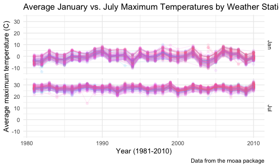
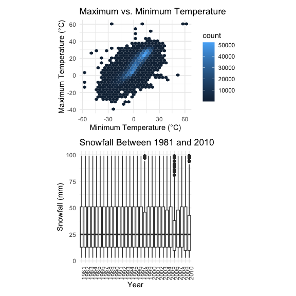
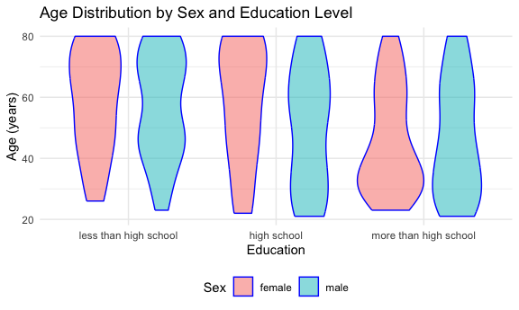
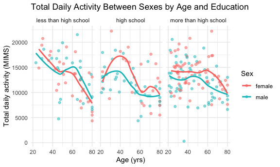
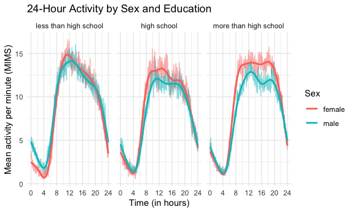
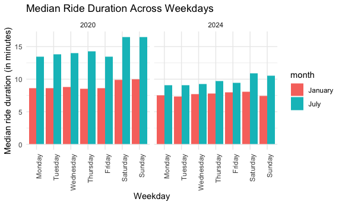
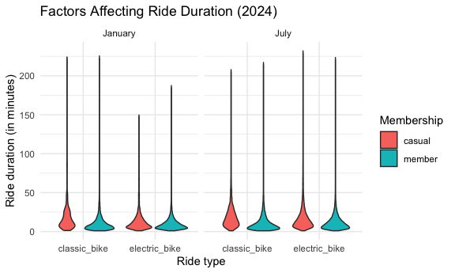

p8105_hw3_ejc2222
================
2026-10-18

# Problem 1

``` r
data("ny_noaa")
```

This data set from the NOAA displays daily observed weather from all New
York State weather stations, January 1, 1981 to December 31, 2010. The
seven key variables include the station ID, date, precipitation,
snowfall, snow depth, daily temperature high, and daily temperature low.
The table dimensions are 2595176 by 7, with missing measurements in the
first ten rows.

``` r
ny_noaa_df = 
  ny_noaa |> 
  janitor::clean_names() |> 
  mutate(
    year = year(date),
    month = month(date, label = TRUE),
    day = day(date),
    prcp = prcp / 10,
    tmax = as.numeric(tmax) / 10,
    tmin = as.numeric(tmin) / 10
  )

snow_counts = 
  ny_noaa_df |>
  count(snow) |>
  arrange(desc(n))
```

### Analyzing the Cleaned Data Set

Looking at the most commonly observed values after cleaning the data
set, 0mm of snowfall appears 2,008,508 times, likely due to the fact
that it rarely snows outside of the winter months. The second most
commonly observed value is NA, totaling 381,221 times, as many weather
stations across New York State do not report snowfall. The next eight
most commonly observed values are 25, 13, 51, 76, 8, 5, 38, and 3 (in
mm).

### Creating a Two-Panel Average Maximum Temperature Plot for January and July

``` r
ny_noaa_df |> 
  filter(month %in% c("Jan", "Jul")) |>
  group_by(id, year, month) |>
  summarize(
    mean_tmax = mean(tmax, na.rm = TRUE)) |>
  ggplot(aes(x = year, y = mean_tmax, group = id)) + 
  geom_point(aes(color = id), alpha = .1) + 
  labs(
    title = "Average January vs. July Maximum Temperatures by Weather Station",
    x = "Year (1981-2010)",
    y = "Average maximum temperature (C)",
    caption = "Data from the rnoaa package") +
  geom_line(aes(color = id), alpha = .1) +
  facet_grid(month ~ .) +
  theme(legend.position = "none")
```

    ## `summarise()` has regrouped the output.
    ## ℹ Summaries were computed grouped by id, year, and month.
    ## ℹ Output is grouped by id and year.
    ## ℹ Use `summarise(.groups = "drop_last")` to silence this message.
    ## ℹ Use `summarise(.by = c(id, year, month))` for per-operation grouping
    ##   (`?dplyr::dplyr_by`) instead.

    ## Warning: Removed 5970 rows containing missing values or values outside the scale range
    ## (`geom_point()`).

    ## Warning: Removed 5932 rows containing missing values or values outside the scale range
    ## (`geom_line()`).



Plotting each station’s average maximum temperature for January and July
from 1981 to 2010 shows that January is consistently colder than July.
January averages generally fall between about -10°C and 10°C, while July
averages fall between about 20°C and 33°C. January also varies more from
year to year than July. In both months, the stations tend to rise and
fall together. For example, nearly every station had a colder-than-usual
January in 1994 and 2004 and a warmer January in 1990 and 2006, which
suggests the year-to-year changes reflect regional weather patterns. A
few notable outliers include one station that averaged a maximum of
about 14°C in July 1988 and another that averaged about -13°C in January
1982.

### Creating Plots for Temperature and Snowfall

``` r
ggp_tmax_tmin = 
  ny_noaa_df |> 
  ggplot(aes(x = tmin, y = tmax)) + 
  geom_hex() +
   labs(
    title = "Maximum vs. Minimum Temperature",
    x = "Minimum Temperature (°C)",
    y = "Maximum Temperature (°C)") +
  theme(legend.position = "right") +
  coord_fixed()

ggp_snowfall = 
  ny_noaa_df |> 
  filter(snow > 0, snow < 100) |> 
  ggplot(aes(x = factor(year), y = snow)) + 
  geom_boxplot() +
  labs(
    title = "Snowfall Between 1981 and 2010",
    x = "Year",
    y = "Snowfall (mm)") +
  theme(axis.text.x = element_text(angle = 90, hjust = 1))

ggp_tmax_tmin / ggp_snowfall
```

    ## Warning: Removed 1136276 rows containing non-finite outside the scale range
    ## (`stat_binhex()`).



# Problem 2

### Organizing NHANES Demographic Data Set

``` r
nhanes_covar_df = 
  read_csv(file = "./data/nhanes_covar.csv", na = c("NA", ".", ""), skip = 4) |>
  janitor::clean_names() |>
  mutate(
    sex = 
      case_match(
        sex, 
        1 ~ "male", 
        2 ~ "female"),
    education =
      case_match(
        education,
        1 ~ "less than high school",
        2 ~ "high school",
        3 ~ "more than high school"),
    education = factor(education, levels = c("less than high school", "high school", "more than high school"))) |>
  filter(age >= 21) |>
  drop_na(age, education, sex)
```

    ## Rows: 250 Columns: 5
    ## ── Column specification ────────────────────────────────────────────────────────
    ## Delimiter: ","
    ## dbl (5): SEQN, sex, age, BMI, education
    ## 
    ## ℹ Use `spec()` to retrieve the full column specification for this data.
    ## ℹ Specify the column types or set `show_col_types = FALSE` to quiet this message.

    ## Warning: There was 1 warning in `mutate()`.
    ## ℹ In argument: `sex = case_match(sex, 1 ~ "male", 2 ~ "female")`.
    ## Caused by warning:
    ## ! `case_match()` was deprecated in dplyr 1.2.0.
    ## ℹ Please use `recode_values()` instead.

``` r
nhanes_covar_df |>
  count(sex, education) |> 
  pivot_wider(
    names_from = sex, 
    values_from = n) |>
  knitr::kable()
```

| education             | female | male |
|:----------------------|-------:|-----:|
| less than high school |     29 |   28 |
| high school           |     23 |   36 |
| more than high school |     59 |   56 |

The table shows that “more than high school” is the largest education
category, with 56 men and 59 women, followed by “high school” (36 men,
23 women) and “less than high school” (28 men, 29 women). Men and women
are roughly balanced in the lowest and highest categories, while men
outnumber women in the high school category.

``` r
nhanes_covar_df |>
  mutate(sex = forcats::fct_relevel(sex, c("female", "male"))) |> 
  ggplot(aes(x = education, y = age)) + 
  geom_violin(aes(fill = sex), color = "blue", alpha = .5) + 
  theme(legend.position = "bottom") +
  labs(
    title = "Age Distribution by Sex and Education Level",
    x = "Education",
    y = "Age (years)",
    fill = "Sex"
  )
```



The violin plots show that participants with more than a high school
education tend to be younger, especially women, whose ages are
concentrated in their 30s, while participants with less than a high
school education skew older for both sexes. In the high school category,
women skew noticeably older than men, with median ages of about 62 and
54, respectively. This pattern may reflect younger generations,
particularly women, having greater access to higher education.

### Organizing Accelerometer Data Set

``` r
nhanes_accel_df = 
  read_csv(file = "./data/nhanes_accel.csv") |>
  janitor::clean_names() |>
  pivot_longer(
    min1:min1440,
    names_to = "minute",
    names_prefix = "min",
    values_to = "activity"
      )
```

    ## Rows: 250 Columns: 1441
    ## ── Column specification ────────────────────────────────────────────────────────
    ## Delimiter: ","
    ## dbl (1441): SEQN, min1, min2, min3, min4, min5, min6, min7, min8, min9, min1...
    ## 
    ## ℹ Use `spec()` to retrieve the full column specification for this data.
    ## ℹ Specify the column types or set `show_col_types = FALSE` to quiet this message.

``` r
nhanes_df = left_join(nhanes_covar_df, nhanes_accel_df, by = "seqn")

nhanes_df |>
  group_by(seqn, sex, age, education) |>
  summarize(
    total_activity = sum(activity)) |>
  drop_na() |>
  ggplot(aes(x = age, y = total_activity, color = sex)) + 
  geom_point(alpha = 0.5) +
  geom_smooth(se = FALSE) + 
  facet_grid(. ~ education) +
  labs(title = "Total Daily Activity Between Sexes by Age and Education",
    x = "Age (yrs)",
    y = "Total daily activity (MIMS)",
    color = "Sex"
  )
```

    ## `summarise()` has regrouped the output.
    ## `geom_smooth()` using method = 'loess' and formula = 'y ~ x'
    ## ℹ Summaries were computed grouped by seqn, sex, age, and education.
    ## ℹ Output is grouped by seqn, sex, and age.
    ## ℹ Use `summarise(.groups = "drop_last")` to silence this message.
    ## ℹ Use `summarise(.by = c(seqn, sex, age, education))` for per-operation
    ##   grouping (`?dplyr::dplyr_by`) instead.



Comparing total daily activity by age for men and women at each
education level, activity varies widely from person to person, but it
generally declines with age within all three education levels for both
sexes, and each decline differs by education:

1.  Among participants with less than a high school education, activity
    drops fairly steadily from the youngest ages, falling from roughly
    18,000 MIMS in the early 20s to about 8,000–9,000 by age 80.

2.  Among participants with a high school education, activity rises to a
    peak around age 40 before declining.

3.  Among those with more than a high school education, activity stays
    fairly flat until about age 60 and then decreases.

Differences between men and women also depend on education level. In the
high school and more than high school groups, women are more active than
men across most of the age range, and the gap is largest in the high
school group around ages 30 to 50. In the less than high school group,
women are slightly more active at younger ages while men are more active
between roughly 50 and 70.

The decline with age may reflect reduced physical capability, along with
factors such as retirement or health conditions, though it should be
noted that these data only capture a single point in time rather than
tracking the same people as they age.

### Accelerometer Data in a 24-Hour Timeframe

``` r
nhanes_df |>
  mutate(hour = as.numeric(minute) / 60) |>
  group_by(education, sex, hour) |>
  summarize(
    mean_activity = mean(activity)
  ) |>
  drop_na() |>
  ggplot(aes(x = hour, y = mean_activity, color = sex)) +
  geom_line(alpha = 0.5) +
  geom_smooth(se = FALSE) +
  facet_grid(. ~ education) +
  labs(title = "24-Hour Activity by Sex and Education",
    x = "Time (in hours)",
    y = "Mean activity per minute (MIMS)",
    color = "Sex") +
  scale_x_continuous(
    breaks = c(0, 4, 8, 12, 16, 20, 24))
```

    ## `summarise()` has regrouped the output.
    ## `geom_smooth()` using method = 'gam' and formula = 'y ~ s(x, bs = "cs")'
    ## ℹ Summaries were computed grouped by education, sex, and hour.
    ## ℹ Output is grouped by education and sex.
    ## ℹ Use `summarise(.groups = "drop_last")` to silence this message.
    ## ℹ Use `summarise(.by = c(education, sex, hour))` for per-operation grouping
    ##   (`?dplyr::dplyr_by`) instead.



Comparing 24-hour activity for men and women, mean activity per minute
(MIMS) follows a similar daily rhythm at every education level. Activity
is lowest overnight, reaching its minimum around 4 a.m., then rises
sharply between about 4 and 9 a.m., stays high during the day, and
declines steeply from about 8 p.m. into midnight. This pattern likely
reflects the sleep-wake cycle, with daytime activity shaped by work and
other daily responsibilities. However, the daytime shape differs by
education level Participants with less than a high school education peak
around 11 a.m. to noon and then decline steadily through the afternoon,
while those with more than a high school education maintain a long
plateau of high activity from about 10 a.m. to 8 p.m.

Across education levels, participants with less than a high school
education have the highest midday peak, at about 15 MIMS per minute.
This is notable given that this group tends to be older, as shown in the
earlier violin plot. One possible explanation is that people with less
formal education are more likely to work in physically demanding jobs.
In this group, men are also noticeably more active overnight than women,
at about 5 MIMS at midnight compared with about 2.5 for women, and they
stay more active until early morning. This may reflect overnight/shift
work.

The difference between women and men during the day grows with education
level. In the more than high school group, women are more active than
men from the morning through the evening, with the largest gap around 4
p.m. (about 14 compared with 11.5 MIMS). In the high school group, women
are also more active during the day, but the gap is smaller. In the less
than high school group, the two lines stay close and briefly cross,
showing little consistent difference between men and women during the
day.

## Problem 3

### Preparing Citi Bike Data

``` r
jan_2020_citi_df = 
  read_csv(file = "./data/jan_2020_citi.csv") |>
  mutate(
    year = 2020,
    month = "January")
```

    ## Rows: 12420 Columns: 7
    ## ── Column specification ────────────────────────────────────────────────────────
    ## Delimiter: ","
    ## chr (6): ride_id, rideable_type, weekdays, start_station_name, end_station_n...
    ## dbl (1): duration
    ## 
    ## ℹ Use `spec()` to retrieve the full column specification for this data.
    ## ℹ Specify the column types or set `show_col_types = FALSE` to quiet this message.

``` r
july_2020_citi_df = 
  read_csv(file = "./data/july_2020_citi.csv") |>
  mutate(
    year = 2020,
    month = "July")
```

    ## Rows: 21048 Columns: 7
    ## ── Column specification ────────────────────────────────────────────────────────
    ## Delimiter: ","
    ## chr (6): ride_id, rideable_type, weekdays, start_station_name, end_station_n...
    ## dbl (1): duration
    ## 
    ## ℹ Use `spec()` to retrieve the full column specification for this data.
    ## ℹ Specify the column types or set `show_col_types = FALSE` to quiet this message.

``` r
jan_2024_citi_df = 
  read_csv(file = "./data/jan_2024_citi.csv") |>
  mutate(
    year = 2024,
    month = "January")
```

    ## Rows: 18861 Columns: 7
    ## ── Column specification ────────────────────────────────────────────────────────
    ## Delimiter: ","
    ## chr (6): ride_id, rideable_type, weekdays, start_station_name, end_station_n...
    ## dbl (1): duration
    ## 
    ## ℹ Use `spec()` to retrieve the full column specification for this data.
    ## ℹ Specify the column types or set `show_col_types = FALSE` to quiet this message.

``` r
july_2024_citi_df = 
  read_csv(file = "./data/july_2024_citi.csv") |>
  mutate(
    year = 2024,
    month = "July")
```

    ## Rows: 47156 Columns: 7
    ## ── Column specification ────────────────────────────────────────────────────────
    ## Delimiter: ","
    ## chr (6): ride_id, rideable_type, weekdays, start_station_name, end_station_n...
    ## dbl (1): duration
    ## 
    ## ℹ Use `spec()` to retrieve the full column specification for this data.
    ## ℹ Specify the column types or set `show_col_types = FALSE` to quiet this message.

``` r
citi_tidy =
  bind_rows(jan_2020_citi_df, july_2020_citi_df, jan_2024_citi_df, july_2024_citi_df) |>
  mutate(weekdays = factor(weekdays, levels = c("Monday", "Tuesday", "Wednesday", "Thursday", "Friday", "Saturday", "Sunday")))
```

The resulting data set shows the combined data on rides taken on the NYC
Citi Bike system, particularly comparing use of the system in the months
of January and July in both 2020 and 2024. Key variables include ride
ID, ride type, weekday, ride duration, start and end station names,
rider status, month, and year. The dimensions of this dataset are 99485
by 9.

``` r
citi_tidy |>
  count(month, year, member_casual) |> 
  pivot_wider(
    names_from = member_casual, 
    values_from = n) |>
  mutate(total_ridership = casual + member,
         year = as.character(year)) |>
  knitr::kable(
    col.names = c("Month", "Year", "Casual", "Member", "Total Rides"),
    format.args = list(big.mark = ","))
```

| Month   | Year | Casual | Member | Total Rides |
|:--------|:-----|-------:|-------:|------------:|
| January | 2020 |    984 | 11,436 |      12,420 |
| January | 2024 |  2,108 | 16,753 |      18,861 |
| July    | 2020 |  5,637 | 15,411 |      21,048 |
| July    | 2024 | 10,894 | 36,262 |      47,156 |

The table shows the number of Citi Bike rides in the dataset for each
month and year, separated by casual riders and members. In both years,
ridership increases from January to July, and casual riders drive much
of that seasonal increase casual rides grew more from January to July in
both 2020 and 2024 compared to membership rides. As a result, casual
riders make up a much larger share of rides in the summer. This likely
reflects tourists and occasional riders using the system more in the
summer months. The seasonal increase was also larger in 2024, when total
rides grew from January to July, compared to 2020. Ridership grew
between the two years as well: January rides increased from 2020 to
2024, and July rides more than doubled. Several factors may contribute
to this growth, including recovery after the COVID-19 pandemic.

### Most Popular Citi Bike Stations in July 2024

``` r
citi_tidy |>
  filter(month == "July", year == 2024) |>
  drop_na(start_station_name) |>
  count(start_station_name) |>
  arrange(desc(n)) |>
  head(5) |>
  knitr::kable(
    col.names = c("Starting station", "Number of rides"))
```

| Starting station         | Number of rides |
|:-------------------------|----------------:|
| Pier 61 at Chelsea Piers |             163 |
| University Pl & E 14 St  |             155 |
| W 21 St & 6 Ave          |             152 |
| West St & Chambers St    |             150 |
| W 31 St & 7 Ave          |             146 |

### Days of the Week, Month, Year and Their Effects on Ride Duration

``` r
citi_tidy |>
  group_by(month, year, weekdays) |>
  summarize(
    median_duration = median(duration)) |>
  ggplot(aes(x = weekdays, y = median_duration, fill = month)) +
  geom_col(position = "dodge") +
  facet_grid(. ~ year) +
  labs(title = "Median Ride Duration Across Weekdays",
    x = "Weekday",
    y = "Median ride duration (in minutes)") +
    theme(axis.text.x = element_text(angle = 90, hjust = 1))
```

    ## `summarise()` has regrouped the output.
    ## ℹ Summaries were computed grouped by month, year, and weekdays.
    ## ℹ Output is grouped by month and year.
    ## ℹ Use `summarise(.groups = "drop_last")` to silence this message.
    ## ℹ Use `summarise(.by = c(month, year, weekdays))` for per-operation grouping
    ##   (`?dplyr::dplyr_by`) instead.



Median ride duration is longer in July than in January on every day of
the week in both years, which likely reflects more leisurely riding in
warmer weather. Weekend rides also tend to be the longest. In July 2020,
the median reached about 16.5 minutes on Saturday and Sunday, compared
with about 13.5 to 14 minutes on weekdays, which suggests more
recreational riding on weekends. January 2024 is an exception: Sunday’s
median (about 7.4 minutes) is among the shortest of the week. Rides were
shorter overall in 2024, with medians of about 7.5 to 8 minutes in
January and 9 to 11 minutes in July, compared with about 8.5 to 10
minutes and 13.5 to 16.5 minutes in 2020. The gap between July and
January also narrowed considerably, from roughly 5 to 6.5 minutes in
2020 to about 1.5 to 3 minutes in 2024. These differences may reflect
the pandemic, since July 2020 rides may have been more recreational, as
well as the growth of electric bikes, which can cover the same distance
in less time, and more members using Citi Bike for routine trips.

### Factors Affecting Ride Duration in 2024

``` r
citi_tidy |>
  filter(year == 2024) |>
  ggplot(aes(x = rideable_type, y = duration, fill = member_casual)) +
  geom_violin() +
  facet_grid(. ~ month) +
  labs(title = "Factors Affecting Ride Duration (2024)",
    x = "Ride type",
    y = "Ride duration (in minutes)",
    fill = "Membership"
  )
```


